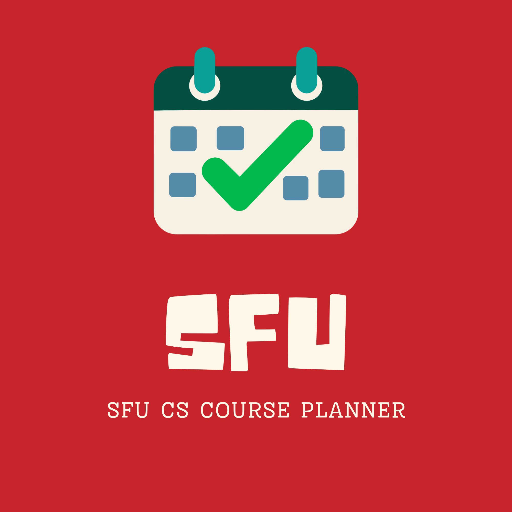

<h4 align="center">
    <br></a>
</h4>


# SFU CS Course Planner

**A full-stack web application to help SFU Computing Science students plan their courses, track degree requirements, check prerequisites, and organize their academic schedules.**

Developed and maintained by the **SFU Open Source Development Club (OS DEV)**.

## About the Project

SFU CS Course Planner is a full-stack web application designed to help Simon Fraser University Computing Science students plan their academic journey more efficiently.

The platform aims to simplify course selection, prerequisite checking, degree requirement tracking, and academic schedule planning through an interactive and user-friendly interface.

This project is part of the **SFU OS DEV Fall 2026 Open Source Project Initiative**, providing students with opportunities to gain hands-on experience in full-stack development, database management, API integration, and collaborative software engineering.

**Project Status:** Early Development — Planning & Initial Setup

## Key Features

The following features are planned for development:

| Feature | Description | Status |
|---|---|---|
| User Accounts | Manage personal academic plans and preferences | Planned |
| Interactive Course Planner | Organize courses by semester using a visual interface | Planned |
| Prerequisite Checker | Verify course prerequisites and dependencies | Planned |
| Degree Progress Tracker | Track completed courses and remaining degree requirements | Planned |
| Course Availability | Explore SFU course offerings and availability through supported data sources | Planned |

Additional features may be proposed and implemented by project contributors.

## Tech Stack

The project uses the following technologies:

| Category | Technologies |
|---|---|
| Frontend | React, TypeScript, Vite |
| Backend | Python, FastAPI |
| Database | PostgreSQL |
| ORM | SQLAlchemy |
| Database Management | Adminer |
| Containerization | Docker, Docker Compose |
| CI/CD | GitHub Actions |
| Version Control | Git, GitHub |

The technology stack may evolve as the project develops.

## Project Architecture

The application follows a full-stack architecture, separating the frontend, backend, and database into independently maintained components.

```text
              React + TypeScript
                (Frontend)
                    |
                    | HTTP / REST API
                    v
              Python + FastAPI
                 (Backend)
                    |
                    | SQLAlchemy
                    v
                PostgreSQL
                 (Database)
                    ^
                    |
                  Adminer
          (Local Database Management)
```

- **Frontend:** Handles the user interface, course planning interactions, and data visualization.
- **Backend:** Provides REST API endpoints, business logic, and data processing.
- **Database:** Stores application data, user information, and course planning records.
- **Adminer:** Provides a browser-based interface for inspecting and managing the local development database.

## Repository Structure

The planned repository structure is:

```text
sfu-cs-course-planner/
├── frontend/
│   ├── src/
│   │   ├── components/
│   │   ├── pages/
│   │   ├── services/
│   │   └── App.tsx
│   └── package.json
│
├── backend/
│   ├── app/
│   │   ├── api/
│   │   ├── models/
│   │   ├── schemas/
│   │   ├── services/
│   │   └── main.py
│   ├── tests/
│   └── requirements.txt
│
├── docs/
│   ├── architecture.md
│   └── setup.md
│
├── .github/
│   ├── workflows/
│   ├── ISSUE_TEMPLATE/
│   └── pull_request_template.md
│
├── .env.example
├── .gitignore
├── compose.yaml
├── CONTRIBUTING.md
├── LICENSE
└── README.md
```

This structure represents the intended architecture and will be updated as development progresses.

## Getting Started

We welcome developers of all experience levels.

### Prerequisites

The planned local development environment uses:

- Git
- Node.js and npm
- Python 3
- Docker Desktop or Docker Engine with Docker Compose
- Visual Studio Code or another preferred IDE

### 1. Fork the Repository

Navigate to the official repository:

https://github.com/sfuosdev/sfu-cs-course-planner

Click **Fork** to create a copy under your personal GitHub account.

### 2. Clone Your Fork

```bash
git clone https://github.com/YOUR_USERNAME/sfu-cs-course-planner.git
cd sfu-cs-course-planner
```

Replace `YOUR_USERNAME` with your GitHub username.

### 3. Add the Official Repository as Upstream

```bash
git remote add upstream https://github.com/sfuosdev/sfu-cs-course-planner.git
```

Verify your remotes:

```bash
git remote -v
```

### 4. Set Up the Development Environment

The frontend, backend, PostgreSQL database, and Adminer development environment will be configured as part of the initial project setup.

Once the application scaffold is available, detailed installation and startup instructions will be maintained in:

`docs/setup.md`

**Note:** The complete application is not yet implemented. The local setup instructions will be updated as the initial development environment becomes available.

## Development Roadmap

Development will be organized into phases.

### Phase 1 — Project Initialization
- [ ] Initialize React + TypeScript frontend
- [ ] Initialize FastAPI backend
- [ ] Configure PostgreSQL and Adminer
- [ ] Set up Docker Compose
- [ ] Establish GitHub Actions CI
- [ ] Configure basic automated tests

### Phase 2 — Course Data Integration
- [ ] Investigate available SFU course data sources
- [ ] Design database schemas for courses and prerequisites
- [ ] Implement course data retrieval and processing
- [ ] Create course-related REST API endpoints

### Phase 3 — Core Functionality
- [ ] Implement interactive course planning
- [ ] Develop prerequisite checking
- [ ] Implement academic semester management
- [ ] Create degree progress tracking

### Phase 4 — User Experience
- [ ] Design responsive user interfaces
- [ ] Improve course search and filtering
- [ ] Implement user account functionality
- [ ] Conduct usability testing

### Phase 5 — Testing & Deployment
- [ ] Expand frontend and backend automated testing
- [ ] Integrate continuous integration workflows
- [ ] Complete application integration testing
- [ ] Prepare public deployment
- [ ] Release an initial working version

Feature priorities and implementation timelines will be determined collaboratively by the project team.

## Contributing

Contributions are welcome from SF
