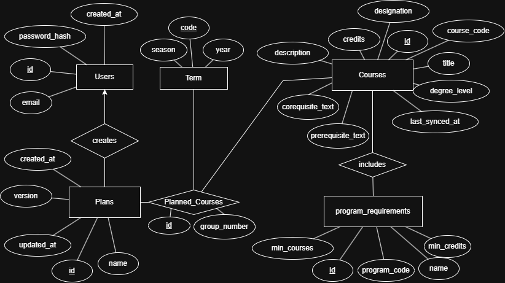

# Architecture

> This describes the planned design. Most of it isn't built yet.

## Components

| Component | Technology              | Responsibility                                      |
| --------- | ----------------------- | --------------------------------------------------- |
| Frontend  | React, TypeScript, Vite | User interface and course planning interactions     |
| Backend   | Python, FastAPI         | REST API, business logic and data processing        |
| Database  | PostgreSQL, SQLAlchemy  | Application data, user information and course plans |
| Adminer   | Adminer                 | Browser-based inspection of the local database      |

## How they connect

React frontend -> REST API -> FastAPI backend -> SQLAlchemy -> PostgreSQL

## Course data

Course data comes from the sfucourses API (`api.sfucourses.com`), an unofficial API
not affiliated with SFU. `docs/sfucourses-api.json` is its Swagger 2.0 description.
It covers course outlines, sections, instructors, prerequisites and reviews.

The backend copies course outlines into its own database. The frontend never calls
the sfucourses API directly; it only calls our backend.

How sfucourses outline fields map to the `Course` model:

| sfucourses field      | `Course` column      | Note                                                                         |
| --------------------- | -------------------- | ---------------------------------------------------------------------------- |
| `dept`                | `dept`               | e.g. `"CMPT"`. Indexed for subject search                                    |
| `number`              | `number`             | e.g. `"225"` or `"105W"`, so stored as a string. `dept` + `number` is unique |
| `dept` + `number`     | `course_code`        | Combined, e.g. `"CMPT 225"`. What the frontend displays                      |
| (built by the loader) | `outline_url`        | Link to the course's official SFU page, or `null`                            |
| `title`               | `title`              |                                                                              |
| `units`               | `credits`            | Sent as a string (`"3"`), stored as an integer                               |
| `description`         | `description`        |                                                                              |
| `designation`         | `designation`        |                                                                              |
| `degreeLevel`         | `degree_level`       |                                                                              |
| `prerequisites`       | `prerequisites_text` |                                                                              |
| `corequisites`        | `corequisites_text`  |                                                                              |

Empty strings from the API are stored as `null`.

The client that fetches this data is `SFUCoursesClient` in
`backend/app/services/sfu_courses.py`. It retrieves outlines and parsed
prerequisite trees, and returns descriptions as plain text. The provider URL and
request timeout can be set with `SFU_COURSES_API_BASE_URL` and
`SFU_COURSES_API_TIMEOUT_SECONDS`.

The loader in `backend/app/services/course_import.py` uses this client to fill the
database. It is run with `python -m app.import_courses` (see
[setup.md](setup.md#import-course-data)), and it:

- Normalizes codes and titles: `dept` and `number` are trimmed and uppercased
  (`" cmpt"`, `"105w "` → `CMPT 105W`), and runs of whitespace in titles become
  single spaces. `units` that aren't a whole number (empty, missing, or text)
  become `0` credits.
- Matches existing courses on `dept` + `number`. A course already in the
  database is updated in place and gets a new `last_synced_at`. If a course
  appears twice in one import, the last copy is used.
- Rebuilds each imported course's `prerequisites` rows from the sfucourses
  prerequisite tree, deleting the old rows first. The conversion is described
  under [Data model](#data-model).
- Runs as one transaction, so a failed import changes nothing.

`designation`, `degree_level` and `outline_url` are not filled yet, because
`SFUCoursesClient` doesn't return those fields.

For now, `GET /courses` (`backend/app/api/courses.py`) calls this client live and
returns its shape (`dept`, `number`, `units`, no `id`). That is temporary: #14
replaces it with a database-backed `GET /api/courses` in the shape described in
[api-contracts.md](api-contracts.md). Don't build frontend code against the
current `/courses` response.

## Data model

The tables are defined as SQLAlchemy models in `backend/app/models/`:

| Table                         | Model                      | Holds                                                                                                |
| ----------------------------- | -------------------------- | ---------------------------------------------------------------------------------------------------- |
| `courses`                     | `Course`                   | One SFU course                                                                                       |
| `prerequisites`               | `Prerequisite`             | A course that another course requires. Rows with the same `group_number` are alternatives            |
| `terms`                       | `Term`                     | An SFU term, keyed by its 4-digit code                                                               |
| `users`                       | `User`                     | An account: email, display username and a hashed password                                            |
| `user_sessions`               | `UserSession`              | A signed-in browser session: a hash of its token and when it expires                                 |
| `plans`                       | `Plan`                     | A user's course plan, with an optional `start_term_code`                                             |
| `plan_courses`                | `PlanCourse`               | One course placed in one `year` and `season` slot of a plan. A course can appear in a plan only once |
| `program_requirements`        | `ProgramRequirement`       | One requirement of a program, e.g. "2 calculus courses"                                              |
| `program_requirement_courses` | `ProgramRequirementCourse` | Links a requirement to the courses that satisfy it                                                   |

A course's prerequisite rows mean "one course from each group". Rows in the same
`group_number` are alternatives, and every group must be satisfied. Groups are
numbered from 1. The same (course, required course, group) can't be stored twice.

The loader converts the sfucourses prerequisite tree like this:

| Tree                                  | Rows                                          |
| ------------------------------------- | --------------------------------------------- |
| one course: `A`                       | group 1: `A`                                  |
| `A and B`                             | group 1: `A`; group 2: `B`                    |
| `A or B`                              | group 1: `A`, `B`                             |
| `A and (B or C)`                      | group 1: `A`; group 2: `B`, `C`               |
| anything else, e.g. `(A and B) or C`  | no rows; only `prerequisites_text` is stored  |

It also skips a required course that isn't in the database, and a course listed
as its own prerequisite.

Known gaps:

- `prerequisites` can't express "(A and B) or (C and D)" or minimum grades, so
  `courses.prerequisites_text` keeps SFU's original wording. For CMPT, 25 of 135
  courses have prerequisite text but no rows. Most of these are requirements like
  "45 units" or "permission of the instructor", but some, such as `CMPT 225`, are
  course requirements in a shape the table can't hold.
- When part of a tree can't be stored, the loader stores the parts it can. Inside
  an `and`, an unsupported part is left out, so the stored requirement can be
  looser than the real one. Inside an `or` group, an alternative that isn't in the
  database is left out, so the stored requirement can be stricter.

## Authentication

Accounts use an email and a password. A signed-in browser holds a random session
token in a cookie, and the backend looks the token up in the `user_sessions` table
on each request. The endpoints are in [api-contracts.md](api-contracts.md#auth).

### Options considered

| Option                                    | Verdict                                                                                                                                        |
| ----------------------------------------- | ---------------------------------------------------------------------------------------------------------------------------------------------- |
| Server-side sessions in an HttpOnly cookie | **Chosen.** Logging out deletes the session, so a copied token stops working. JavaScript can't read the cookie, which limits what an XSS bug can steal. Needs one table and no new auth library |
| JWT sent in an `Authorization` header      | Stateless, but a JWT can't be revoked before it expires, so logout only forgets the token in the browser. The frontend also has to store it where scripts can read it |
| JWT in an HttpOnly cookie                  | Safer storage than the header, but still can't be revoked, and adds a JWT library and key management                                           |
| SFU login (CAS) or Google/GitHub OAuth     | No passwords to store, but SFU CAS needs the university to register the app, and OAuth adds a provider to set up and depend on. Could be added later |

### How it works

- **Passwords** are hashed with Argon2 (`backend/app/services/passwords.py`) and are
  never stored or returned. Passwords must be 8 to 128 characters.
- **Emails** are stored trimmed and lowercase, so `Student@SFU.ca` and
  `student@sfu.ca` are the same account.
- **Sessions:** login creates a 32-byte random token and sets it in the `session`
  cookie. Only its SHA-256 hash is stored, so a leaked database doesn't leak working
  sessions. A session lasts `SESSION_TTL_DAYS` (default 7), then is rejected and
  deleted. Every login gets a new token, and logout deletes the session on the server.
- **Cookie flags:** `HttpOnly`, `SameSite=Lax`, `Path=/`, and `Secure` unless
  `APP_ENV` is `development` (override with `SESSION_COOKIE_SECURE`).
- **Failed logins** return the same `401` for a wrong password and an unknown email,
  and the backend does the same amount of hashing work for both.
- **Plan access:** every plan belongs to one user through `plans.user_id`. Routes
  under `/api/plans` take the user from the session and never from the request, and
  look plans up with `get_owned_plan` in `backend/app/api/deps.py`. A plan that
  belongs to someone else gets the same `404` as one that doesn't exist. New routes
  that take a `plan_id` should depend on `get_owned_plan` too.

### Known gaps

- No rate limiting or lockout on login or sign-up. Argon2 makes each guess slow, but
  repeated guesses aren't blocked.
- No CSRF token. `SameSite=Lax` stops other sites from sending the cookie with
  `POST`, `PATCH` and `DELETE` requests, and no state-changing route uses `GET`.
  Revisit this if the frontend is ever served from a different site than the API.
- No email verification or password reset.
- The frontend doesn't have login pages yet. Serving the frontend and API from one
  origin (for example a Vite dev proxy for `/api`) or adding CORS with credentials is
  needed before it can use the cookie.
- Sign-up returns `409` for an email that's taken, which reveals that the account
  exists.
- `er-diagram.png` doesn't show `user_sessions` yet.

## API

The REST API between the frontend and backend is described in
[api-contracts.md](api-contracts.md). Its request and response shapes are Pydantic
schemas in `backend/app/schemas/`.

## Repository layout

- `frontend/src/`: `components/`, `pages/` and `services/`
- `backend/app/`: `api/`, `models/`, `schemas/` and `services/`
- `backend/tests/`: backend tests
- `docs/`: project documentation
