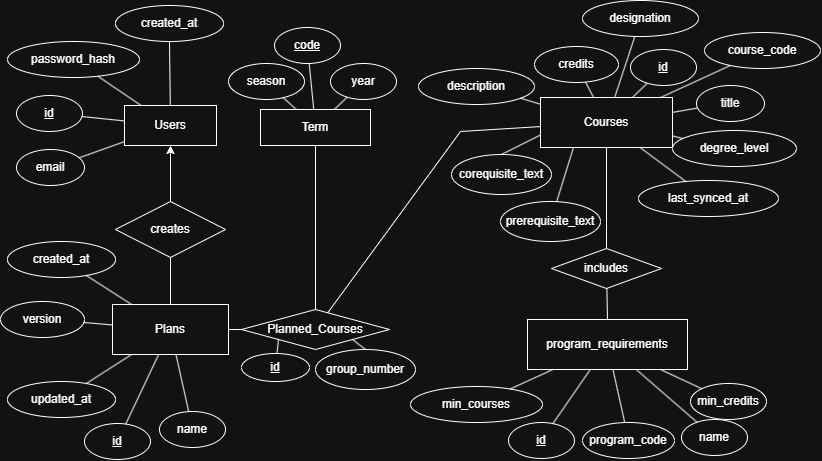

# Architecture

> This describes the planned design. Most of it isn't built yet.

## Components

| Component | Technology              | Responsibility                                      |
| --------- | ----------------------- | --------------------------------------------------- |
| Frontend  | React, TypeScript, Vite | User interface and course planning interactions     |
| Backend   | Python, FastAPI         | REST API, business logic and data processing        |
| Database  | PostgreSQL, SQLAlchemy  | Application data, user information and course plans |
| Adminer   | Adminer                 | Browser-based inspection of the local database      |

## How they connect

React frontend -> REST API -> FastAPI backend -> SQLAlchemy -> PostgreSQL

## Course data

Course data comes from the sfucourses API (`api.sfucourses.com`), an unofficial API
not affiliated with SFU. `docs/sfucourses-api.json` is its Swagger 2.0 description.
It covers course outlines, sections, instructors, prerequisites and reviews.

The backend copies course outlines into its own database. The frontend never calls
the sfucourses API directly; it only calls our backend.

How sfucourses outline fields map to the `Course` model:

| sfucourses field | `Course` column | Note |
|---|---|---|
| `dept` + `number` | `course_code` | Combined, e.g. `"CMPT 225"` |
| `title` | `title` | |
| `units` | `credits` | Sent as a string (`"3"`), stored as an integer |
| `description` | `description` | |
| `designation` | `designation` | |
| `degreeLevel` | `degree_level` | |
| `prerequisites` | `prerequisites_text` | |
| `corequisites` | `corequisites_text` | |

Empty strings from the API are stored as `null`.

## Data model

The tables are defined as SQLAlchemy models in `backend/app/models/`:

| Table | Model | Holds |
|---|---|---|
| `courses` | `Course` | One SFU course |
| `prerequisites` | `Prerequisite` | A course that another course requires. Rows with the same `group_number` are alternatives |
| `terms` | `Term` | An SFU term, keyed by its 4-digit code |
| `plans` | `Plan` | A user's course plan |
| `plan_courses` | `PlanCourse` | One course placed in one term of a plan |
| `program_requirements` | `ProgramRequirement` | One requirement of a program, e.g. "2 calculus courses" |
| `program_requirement_courses` | `ProgramRequirementCourse` | Links a requirement to the courses that satisfy it |

Known gaps:

- `plans.user_id` references a `users` table that doesn't exist yet. It will be
  added with authentication.
- `prerequisites` can't express "(A and B) or (C and D)" or minimum grades, so
  `courses.prerequisites_text` keeps SFU's original wording.

## API

The REST API between the frontend and backend is described in
[api-contracts.md](api-contracts.md). Its request and response shapes are Pydantic
schemas in `backend/app/schemas/`.

## Repository layout

- `frontend/src/`: `components/`, `pages/` and `services/`
- `backend/app/`: `api/`, `models/`, `schemas/` and `services/`
- `backend/tests/`: backend tests
- `docs/`: project documentation
